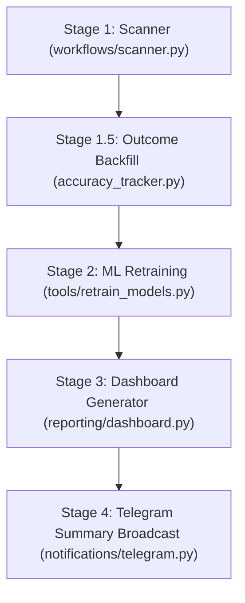

# CodeGraph: Praecursor-EGX Architecture & Symbol Index

This skill provides an immediate, cached structural representation of the Praecursor-EGX codebase, enabling zero-latency code navigation.

## 🚀 Quick Symbol & Location Reference

| Category | Component / Symbol | File Location | Key Functions / Classes |
| :--- | :--- | :--- | :--- |
| **Pipeline Runner** | Autonomous 5-Stage Pipeline | [`tools/run_autonomous_pipeline.py`](file:///C:/Users/moody/.gemini/antigravity/scratch/Praecursor-EGX/tools/run_autonomous_pipeline.py) | `run_stage()`, `main()` |
| **Scanner Engine** | Core Scanner Workflow | [`src/praecursor/workflows/scanner.py`](file:///C:/Users/moody/.gemini/antigravity/scratch/Praecursor-EGX/src/praecursor/workflows/scanner.py) | `ScannerWorkflow`, `SymbolScanResult`, `ScannerRunResult` |
| **Scoring Engine** | Base Opportunity Scorer | [`src/praecursor/scoring/opportunity_score.py`](file:///C:/Users/moody/.gemini/antigravity/scratch/Praecursor-EGX/src/praecursor/scoring/opportunity_score.py) | `OpportunityScorer`, `OpportunityScore` |
| **Next-Day Alpha** | Next-Day Explosion Model | [`src/praecursor/scoring/next_day.py`](file:///C:/Users/moody/.gemini/antigravity/scratch/Praecursor-EGX/src/praecursor/scoring/next_day.py) | `calculate_next_day_prediction`, `NextDayPrediction` |
| **Regime Filter** | Market Regime Classifier | [`src/praecursor/scoring/regime.py`](file:///C:/Users/moody/.gemini/antigravity/scratch/Praecursor-EGX/src/praecursor/scoring/regime.py) | `MarketRegimeModel`, `MarketRegime` |
| **Consensus Engine** | Multi-Source Price Consensus | [`src/praecursor/consensus/price_consensus.py`](file:///C:/Users/moody/.gemini/antigravity/scratch/Praecursor-EGX/src/praecursor/consensus/price_consensus.py) | `PriceConsensusEngine`, `PriceConsensusResult` |
| **Outcome Tracking** | Automated Feedback Loop | [`src/praecursor/analysis/accuracy_tracker.py`](file:///C:/Users/moody/.gemini/antigravity/scratch/Praecursor-EGX/src/praecursor/analysis/accuracy_tracker.py) | `track_outcomes_from_db`, `AccuracyTracker` |
| **ML Retraining** | XGBoost / LightGBM Training | [`tools/retrain_models.py`](file:///C:/Users/moody/.gemini/antigravity/scratch/Praecursor-EGX/tools/retrain_models.py) | `extract_features`, `main()`, `INDICATOR_TO_FEATURE` |
| **Telegram Dispatch** | Live Formatting & Delivery | [`src/praecursor/notifications/telegram.py`](file:///C:/Users/moody/.gemini/antigravity/scratch/Praecursor-EGX/src/praecursor/notifications/telegram.py) | `dispatch_telegram_scan_briefing`, `TelegramClient` |
| **Database Storage** | SQLite Cache & Signals | [`src/praecursor/storage/signal_history.py`](file:///C:/Users/moody/.gemini/antigravity/scratch/Praecursor-EGX/src/praecursor/storage/signal_history.py) | `SignalHistoryStore`, `PriceCache` |

---

## 🏗️ 5-Stage Autonomous Pipeline Architecture

---

## 📊 Database Schema (`database/praecursor.db`)

1. `source_prices`: Historical OHLCV bars (`ticker`, `trade_date`, `open`, `high`, `low`, `close`, `volume`, `source`).
2. `scanner_runs`: Execution logs (`id`, `generated_at`, `source_name`, `symbols`, `success_count`).
3. `scanner_signals`: Per-symbol scores and indicator snapshots (`run_id`, `rank`, `symbol`, `opportunity_score`, `next_day_score`, `next_day_label`, `indicator_values_json`).
4. `scanner_signal_outcomes`: Ground truth resolution (`run_id`, `symbol`, `signal_date`, `next_day_hit`, `next_day_return`, `next_day_max_return`).

---

## 🔍 Detailed References

* See [`praecursor_egx_graph.md`](./references/praecursor_egx_graph.md) for full module trees, feature vectors, indicator catalogs, and signal formulas.
